

# NØIR

**A premium, offline-first music player.**

Your music. Your device. No noise.

Available for **Windows** and **Android**.

---

## Overview

NØIR is a beautifully crafted music player for the desktop and for your pocket.
It is built on a single idea: your library should be instant, private, and always
available — even with the connection off.

- **Offline-first.** Browse and play without ever touching a network.
- **A real library.** Songs, albums, artists, playlists, favorites, and play
  history — organised and instantly searchable.
- **Fast and quiet.** A focused, keyboard-friendly interface that stays out of
  the way of the music.

## Highlights

- **Now Playing** — full-screen artwork with seek, shuffle, repeat and volume,
  plus a mini player that follows you across the app.
- **Queue** — line up what's next and reorder on the fly.
- **Playlists & Favorites** — shape your own collections and mark the tracks you
  love.
- **Recently & Mostly Played** — your listening habits, remembered.
- **Powerful search** — jump straight to any song, album, artist, or playlist,
  with a command palette for everything else.
- **Lyrics** — read along, right inside the player.
- **Five themes** — NOIR, OBSIDIAN, MIDNIGHT, EMBER, and IVORY.
- **Optional sign-in** — keep your favorites, history, and playlists tied to
  your own account. Entirely optional; NØIR works without it.

## Platforms

|            | Windows                    | Android                |
| ---------- | -------------------------- | ---------------------- |
| Library    | A folder on your machine   | Music on your device   |
| Playback   | Fully local                | Fully local            |
| Offline    | Yes                        | Yes                    |
| Appearance | Frameless, resizeable      | Native, edge-to-edge   |

## Screenshots — Desktop

| Home | Now Playing |
| :--: | :---------: |
| 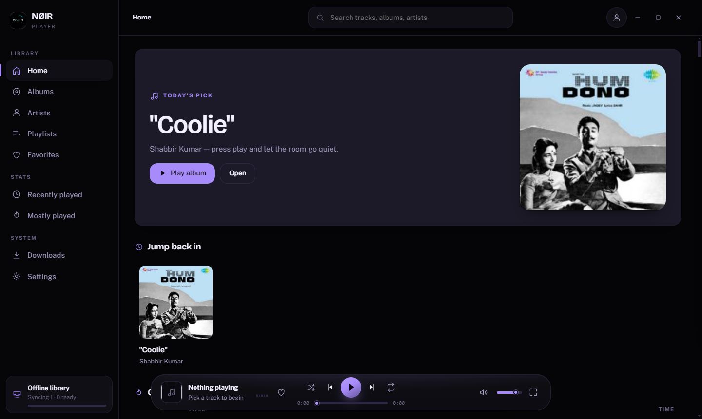 | 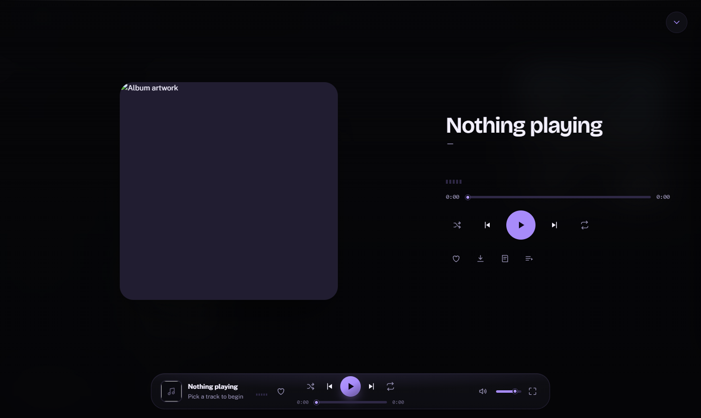 |

| Albums | Artists |
| :----: | :-----: |
| 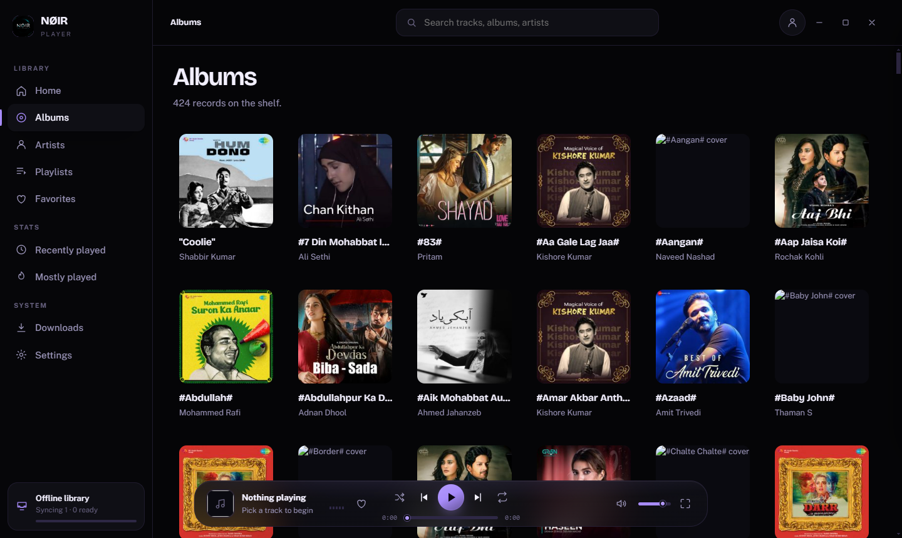 | 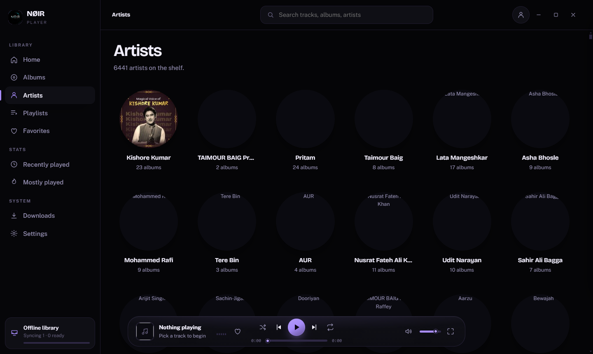 |

| Playlists | Queue |
| :-------: | :---: |
| 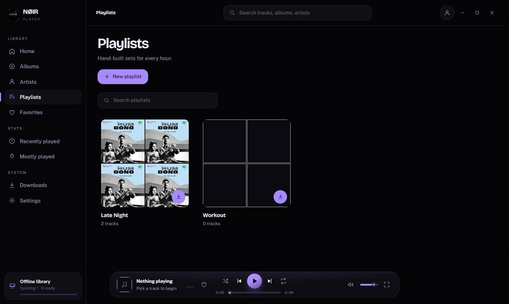 | 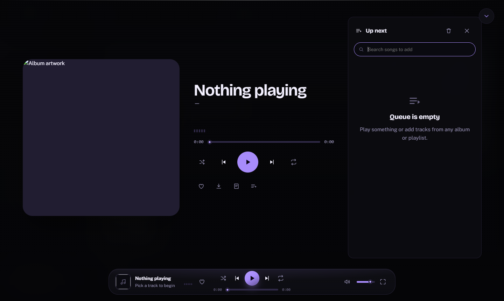 |

| Lyrics | Search |
| :----: | :----: |
| 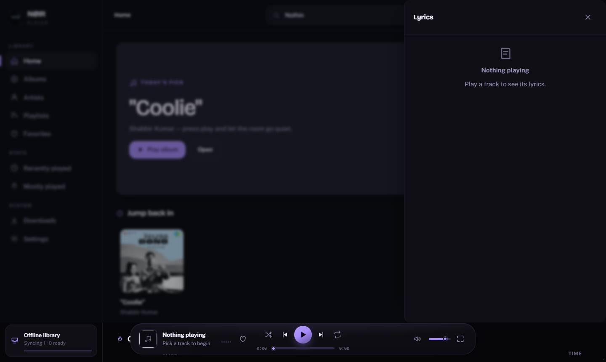 | 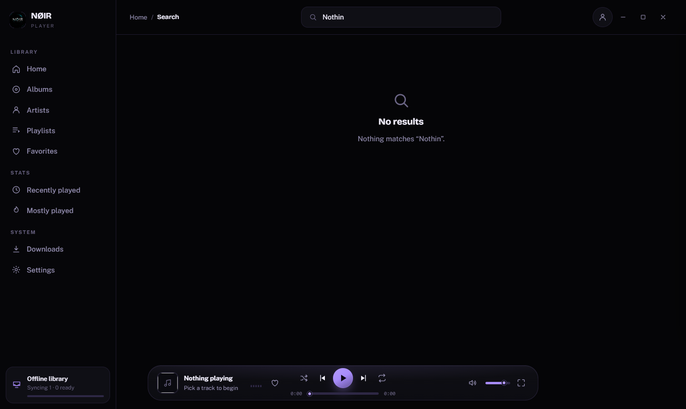 |

| Favorites | Recently Played |
| :-------: | :-------------: |
| 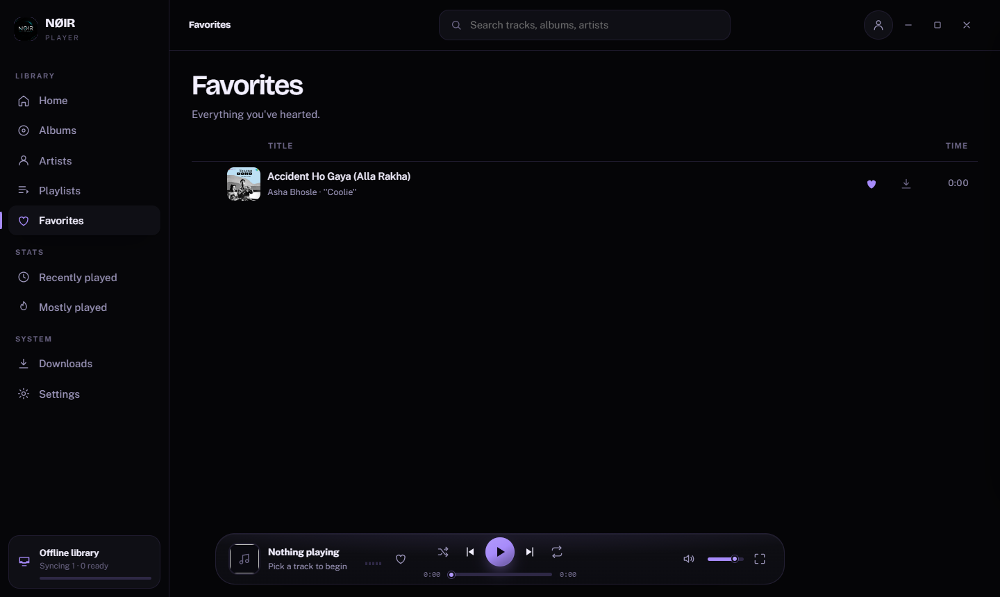 | 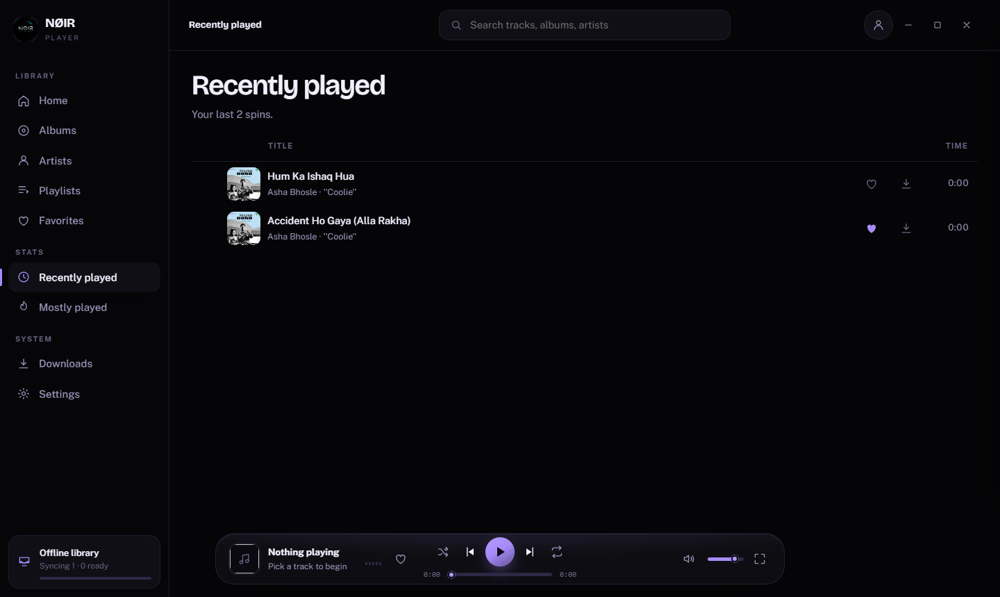 |

| Offline Availability | Settings |
| :------------------: | :------: |
| 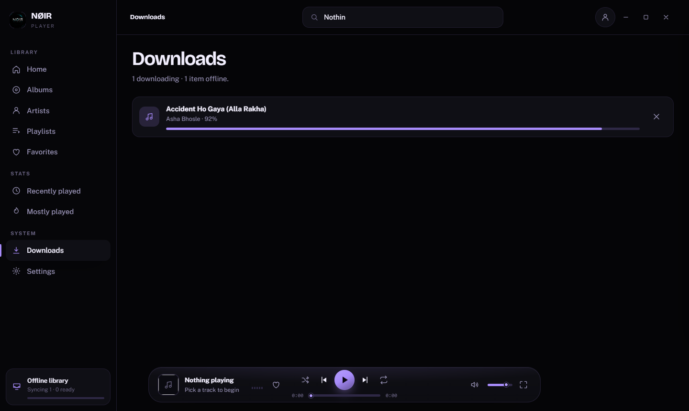 | 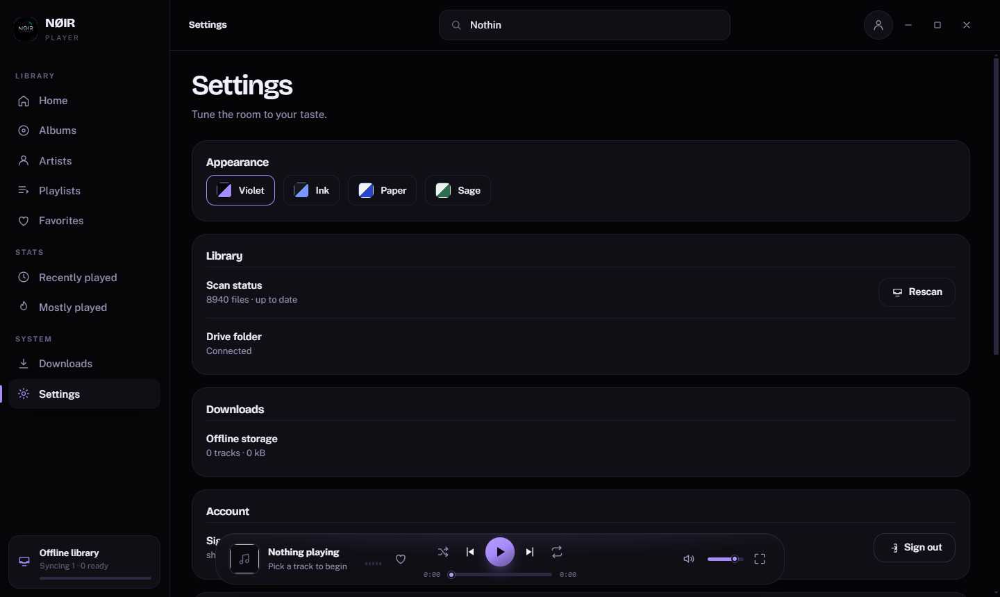 |

More desktop screenshots — album, artist, playlist, command palette, and the
new-playlist dialog — live in [`desktop/`](desktop).

## Screenshots — Android

| Home | Library | Search |
| :--: | :-----: | :----: |
|  |  |  |

| Now Playing | Queue | Settings |
| :---------: | :---: | :------: |
|  |  |  |

## Built with

- **Desktop** — Electron with a hand-written HTML / CSS / JavaScript renderer,
  no framework and no bundler.
- **Android** — Capacitor with a native audio playback service and a
  MediaSession-driven notification and lock-screen experience.

## License

© NØIR. All rights reserved.
