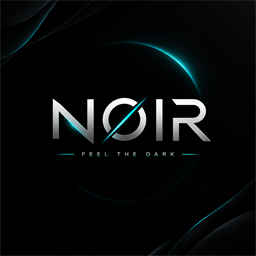
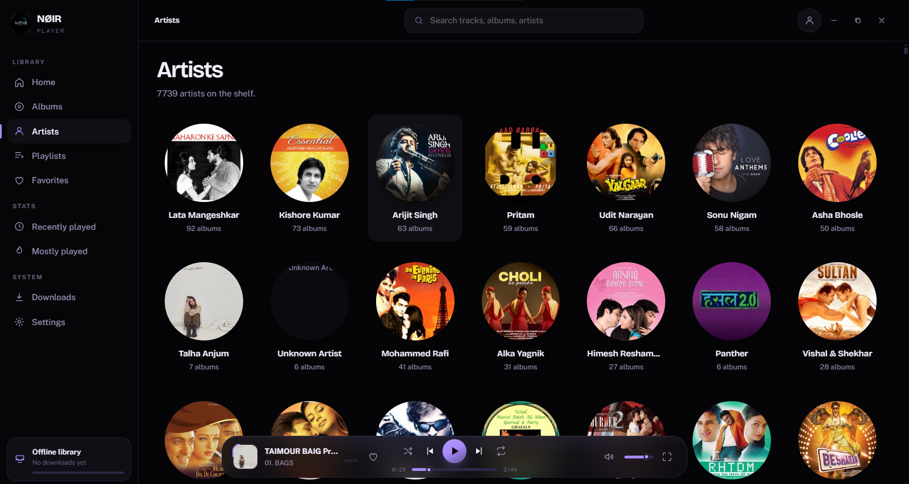
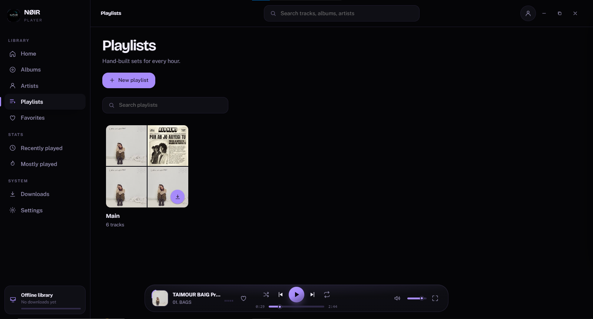
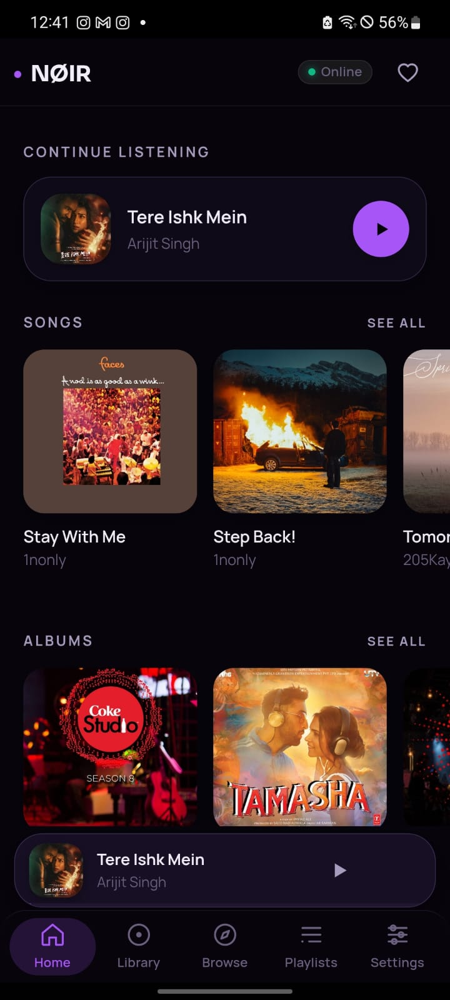
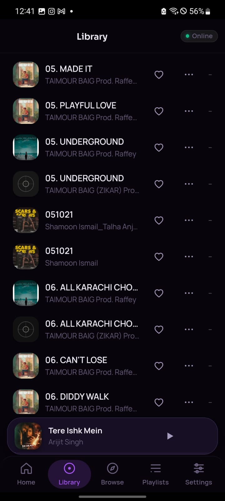
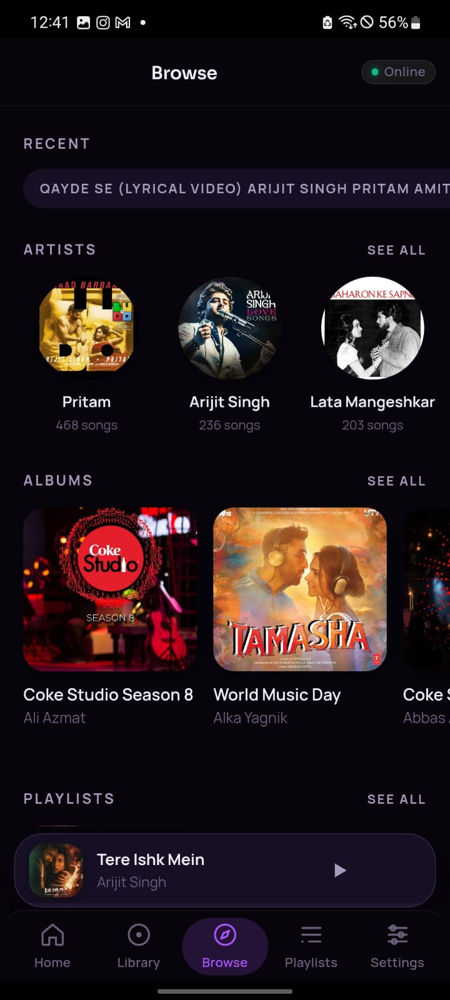
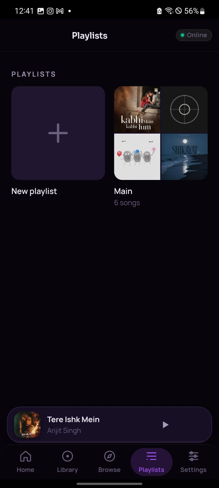
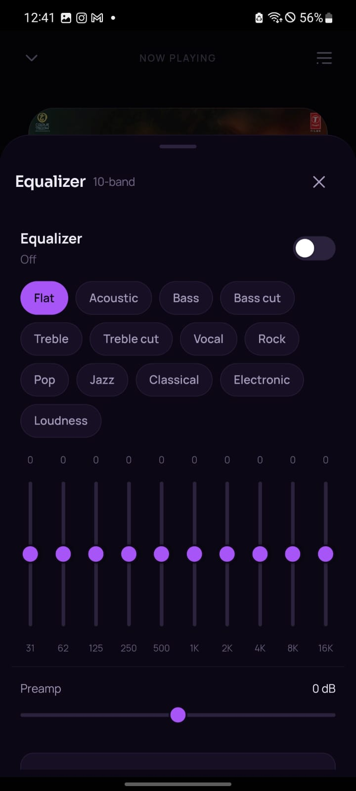
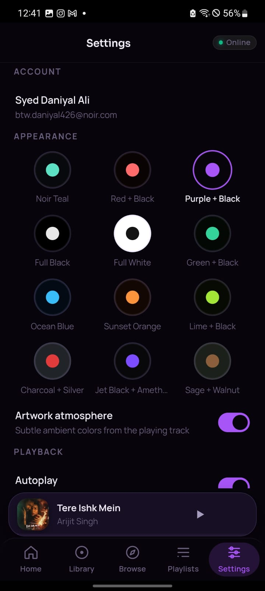

# NØIR

**A premium, invitation-only music player.**

Your music. Your device. No noise.

Available for **Windows** and **Android**.

---

## Overview

NØIR is a beautifully crafted music player for the desktop and for your pocket.
It is built on a single idea: your library should be instant, private, and always
at hand.

- **Invitation-based.** NØIR is not open to everyone. You need an invite to
  create an account and step inside — and once you're in, the whole catalogue
  unlocks.
- **A real library.** Songs, albums, artists, playlists, favorites, and play
  history — organised and instantly searchable.
- **Fast and quiet.** A focused, keyboard-friendly interface that stays out of
  the way of the music.

## Getting In

Access is gated on purpose, so the community stays small and the music keeps
playing.

1. **Get an invite.** Ask a friend inside NØIR, or wait for an invite from the
   team.
2. **Create your account.** Sign up with your email, your invite code and a
   password.
3. **Sign in.** Your favourites, playlists and listening history follow you
   across every device you own.

Already have an account? Just sign in — and stay signed in with **Remember
me**.

## Highlights

- **Now Playing** — full-screen artwork with seek, shuffle, repeat and volume,
  plus a mini player that follows you across the app.
- **Queue** — line up what's next and reorder on the fly.
- **Home** — a **Today's Pick** for the day, **Jump back in** to what you were
  listening to, and curated shelves like **Love Anthems**.
- **Playlists & Favorites** — shape your own collections and mark the tracks you
  love.
- **Recently & Mostly Played** — your listening habits, remembered.
- **Powerful search** — jump straight to any song, album, artist, or playlist,
  with a command palette for everything else.
- **Lyrics** — read along, right inside the player.
- **10-band Equalizer** — on Android, shape the sound with presets and a
  preamp.
- **Ambient themes** — a deep palette of hand-tuned themes, plus an *artwork
  atmosphere* that pulls subtle colour from whatever is playing.
- **Downloads** — keep tracks on device and listen without a connection.

## Screenshots — Desktop

| Sign in | Home |
| :----: | :---: |
|  |  |

| Now Playing | Artists |
| :---------: | :-----: |
|  |  |

| Playlists |
| :-------: |
|  |

## Screenshots — Android

| Home | Library |
| :--: | :-----: |
|  |  |

| Browse | Now Playing |
| :----: | :---------: |
|  |  |

| Playlists | Equalizer |
| :-------: | :---: |
|  |  |

| Settings |
| :------: |
|  |

## Platforms

|            | Windows                    | Android                |
| ---------- | -------------------------- | ---------------------- |
| Library    | Full catalogue, streamed   | Full catalogue, streamed |
| Playback   | Fully local                | Fully local            |
| Access     | Invite code required       | Invite code required   |
| Appearance | Frameless, resizeable      | Native, edge-to-edge   |

## Built with

- **Desktop** — Electron with a hand-written HTML / CSS / JavaScript renderer,
  no framework and no bundler.
- **Android** — Capacitor with a native audio playback service and a
  MediaSession-driven notification and lock-screen experience.

